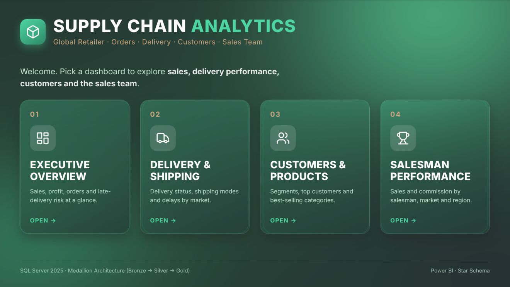
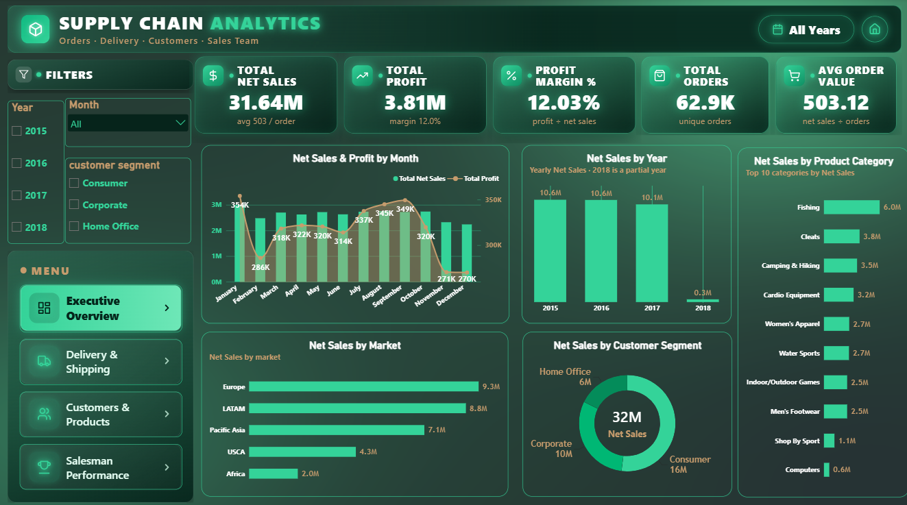
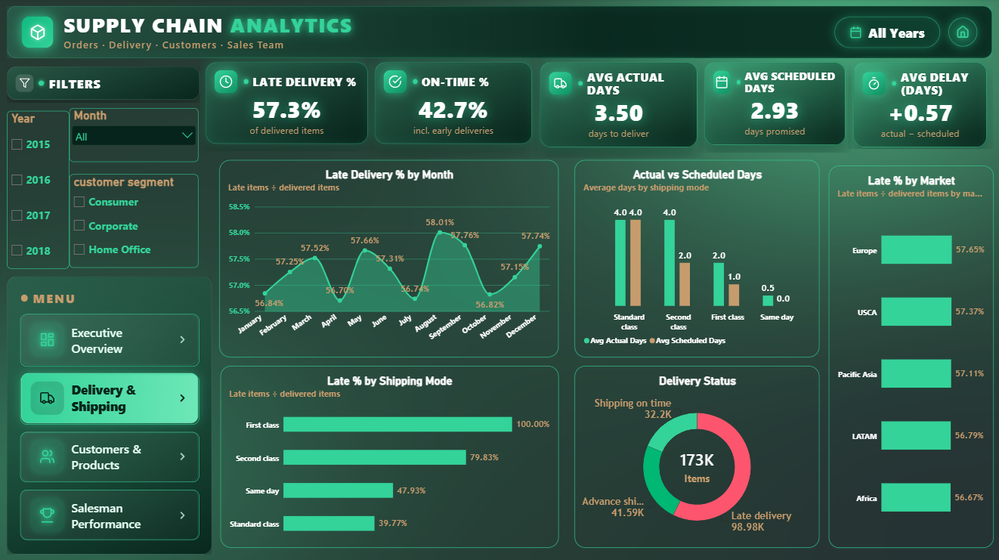
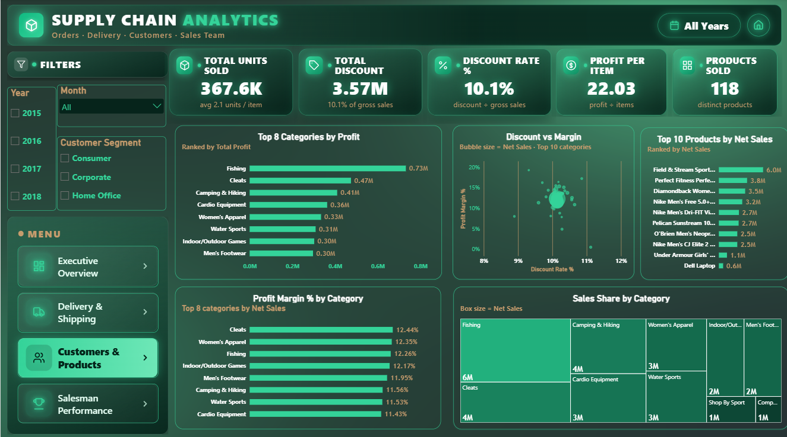
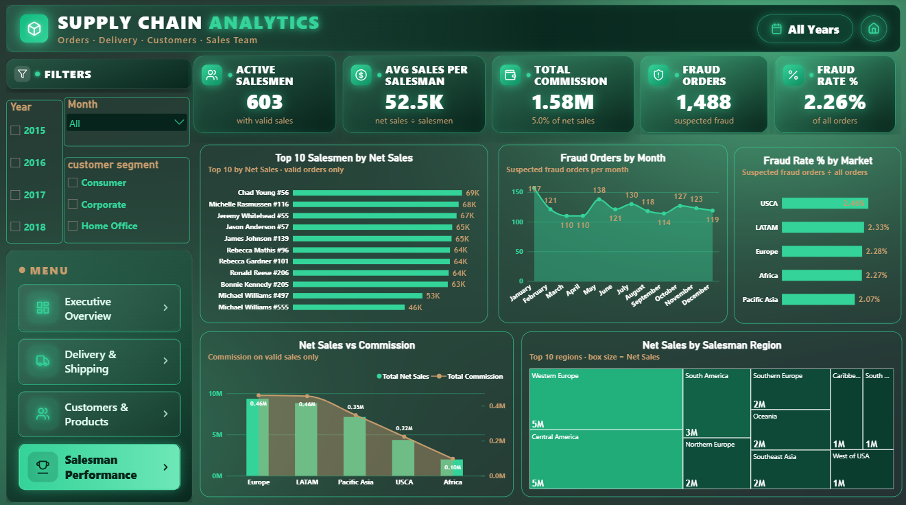

# Global Supply-Chain Analytics
### SQL Server Medallion Data Warehouse + Power BI

An end-to-end analytics project for a global supply-chain retailer. Raw flat files are loaded into **SQL Server 2025**, cleaned and modelled in **pure T-SQL** using the **Medallion Architecture** (Bronze → Silver → Gold), and served through a **5-page Power BI report** with custom HTML/SVG KPI cards.



## Table of Contents
1. [Project Overview](#project-overview)
2. [Architecture and Data Flow](#architecture-and-data-flow)
3. [Data Model](#data-model)
4. [Data Quality Issues](#data-quality-issues)
5. [Business Rules](#business-rules)
6. [Dashboards](#dashboards)
7. [Key Insights](#key-insights)
8. [Limitations and Next Steps](#limitations-and-next-steps)
9. [Repository Structure](#repository-structure)
10. [How to Run](#how-to-run)
11. [Tech Stack](#tech-stack)

## Project Overview
| Item | Detail |
|---|---|
| Source | 4 flat files: Customers, Products, Orders, Salesman |
| Volume | 180,519 order items |
| Warehouse | SQL Server 2025, T-SQL only |
| Reporting | Power BI (DAX, custom HTML Content visuals) |
| Goal | Answer sales, delivery, product and salesman/fraud questions from one consistent model |

## Architecture and Data Flow

```
 Source files (CSV)
        │  Load
        ▼
 ┌─────────────┐   ┌──────────────────┐   ┌──────────────────────┐   ┌───────────┐
 │   BRONZE    │ → │      SILVER      │ → │         GOLD         │ → │ POWER BI  │
 │ raw, all    │   │ typed, cleaned,  │   │ star schema:         │   │ DAX model │
 │ VARCHAR     │   │ standardized,    │   │ 4 dims + FactOrders  │   │ 5 pages   │
 │ no changes  │   │ de-duplicated    │   │ with foreign keys    │   │           │
 └─────────────┘   └──────────────────┘   └──────────────────────┘   └───────────┘
```

| Layer | Purpose | Rules |
|---|---|---|
| **Bronze** | Raw copy of the sources | Every column `VARCHAR`, nullable, no keys. Never altered, so the pipeline can always be re-run from the source |
| **Silver** | Typed and cleaned data | `TRY_CAST`, trimming, category mapping, de-duplication, primary keys |
| **Gold** | Reporting star schema | `DimCustomers`, `DimProducts`, `DimSalesman`, `DimDate`, `FactOrders` with referential integrity |

Each layer is validated before the next one is built (row counts, NULL checks, key uniqueness, orphan checks).

## Data Model
### Supply Chain Star Schema


- **Grain of `FactOrders`:** one row per order item (`Order_Item_Id`). `Order_Id` repeats, so it is kept as a degenerate dimension and counted with `DISTINCTCOUNT`.
- `DimDate` covers the full order-date range and is related to the fact on the **order date**.
- `Salesman_Email` is excluded from Gold (personal data).

## Data Quality Issues

| Issue | Resolution |
|---|---|
| `Market` appeared in 12 spellings | Mapped to 5 values: Africa, Europe, LATAM, Pacific Asia, USCA |
| `Shipping_Mode` appeared in 9 spellings | Mapped to 4 standard values |
| Extra spaces and inconsistent casing | Trim, collapse spaces, standardize casing |
| 8 customers with a missing last name | Replaced with `Unknown` |
| `Order_Zipcode` entirely NULL | Dropped in Silver |
| Numbers and dates loaded as text | `TRY_CAST`; failed conversions counted before the load |
| Two salesmen share one full name | A label with `Salesman_Id` is used in visuals |
| `Late_delivery_risk` is identical to `Delivery_Status = 'Late delivery'` (98,977 rows) | Documented as redundant and not used as a predictor |

## Business Rules
- **Valid orders** = all orders except `Canceled` and `Suspected fraud`. The same filter is inside every measure so all numbers describe the same set of orders.
- `Order_Item_Total` is after discount, so `Discount Rate % = Discount / (Net Sales + Discount)`.
- **Late %** is calculated on delivered items (excluding `Shipping canceled`). Early deliveries count as on time.
- **Fraud measures** ignore the valid-orders filter, and the fraud rate is divided by all orders.
- **Commission** = item sales × the commission rate of that item's salesman, valid orders only.
- KPI cards compare against the previous month (month selected) or previous year (year selected).

## Dashboards

### Executive Sales & Profit Overview

Net sales, profit, margin, orders and AOV, with trends by month and year and breakdowns by market, category and segment.

### Delivery & Shipping Performance

Late and on-time rates, actual vs scheduled days, delivery status mix, and late % by shipping mode, market and month.

### Product & Category Performance

Units, discounts, discount rate and profit per item, with top categories and products.

### Salesman & Fraud Performance

Active salesmen, commission, fraud orders and rate, top salesmen and fraud by market.

## Key Insights
- **First Class was late on 100%** of delivered items, versus about 48% for Same Day and 40% for Standard Class.
- **Late rate is flat across markets** (56.7% to 57.7%), so shipping mode drives delays, not geography.
- **Discounts are about 10% in every category**, and margins of the largest categories sit within 11 to 12%.
- **2018 is a partial year**, so its totals are not comparable with 2015 to 2017.

## Limitations and Next Steps
- `DimDate` is related on the order date only. An inactive relationship on the shipping date with `USERELATIONSHIP` would enable shipping-date analysis.
- Fraud analysis is descriptive; no predictive model is used.

## Documentation
- Architecture & Data Flow: [English](docs/Sprint4_Documentation_EN.docx) · [العربية](docs/Sprint4_Documentation.docx)
- Short Write-up (design decisions, data quality issues, challenges): [English](docs/Sprint4_WriteUp_EN.docx) · [العربية](docs/Sprint4_WriteUp.docx)

## Repository Structure
```
sql/       T-SQL scripts: Bronze, Silver, Gold, validation
DAX/       base measures and HTML/SVG card measures
assets/    Power BI theme and background images
images/    star schema and dashboard screenshots
docs/      documentation and write-up (Word, English and Arabic)
```

## How to Run
1. Create the database and run the Bronze scripts, then load the four source files.
2. Run the Silver scripts, then the Gold scripts, in that order.
3. Open the Power BI report, point it at the `Gold` tables, and apply `assets/SupplyChain_Green_Theme.json`.
4. Add the measures from `DAX/` (start with `01_base_measures`).
---

# 👤 About Me

## Youssef Mohamed

*Data Analytics | SQL | Power BI | DAX | Business Intelligence*

🔗 [LinkedIn Profile](https://www.linkedin.com/in/youssef-mohamed-6038092b2/)

🔗 [GitHub Profile](https://github.com/youssef-mohamed004)

---
## Tech Stack
SQL Server 2025 (T-SQL) · Power BI · DAX · HTML/SVG (HTML Content visual)
